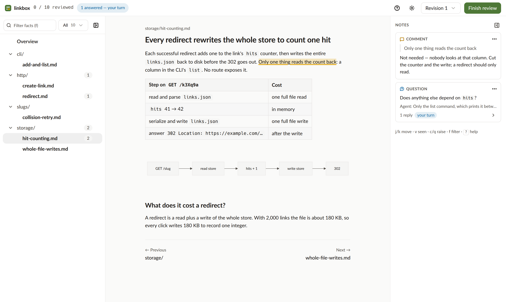

# Gloss

**Audit what your agent built, one claim at a time.** Gloss turns the
state of a system, its design, or a plan into a tree of small Markdown
facts you can check in detail — cut what isn't needed, change what's
wrong, and take back control of what actually gets built.

Agent-built software collects things nobody asked for: a fallback
here, an extra mode there, two components where one would do. In a
long plan or a large diff they slip past. Split into one decidable
claim per file, each is small enough to judge and easy to strike.



## How it works

1. Point the skill at anything — a running system, a feature, the
   recent changes, a design doc, a plan, a whole repo. Your prompt is
   the scope.
2. The agent condenses what it finds into a **fact tree**: small,
   decidable claims, each carrying the evidence to judge it —
   screenshots, transcripts, probes captured from the running app —
   so you audit the design without reading the source.
3. You review with the moves you know from code review. **Comment**
   on a fact to cut, simplify, or change it: the agent resolves every
   comment in the next revision of the tree. **Ask** to understand:
   the agent answers in the thread, live, while you keep reading.
   Notes on the overview, the tree's front page, speak to the review
   as a whole — its altitude, its focus, or a request for a cold read.
4. When the tree says what you mean, approve it. The approved design
   is what the agent implements.

## Install

```sh
npm install -g gloss-review          # `gloss` on PATH (Node 18+)
gloss skill install --global         # or --agents for .agents/skills
```

The install is the only time you touch the CLI — your agent drives
everything else, including the viewer.

## Use

Invoke the skill with whatever you want reviewed:

```
/gloss all the pages, components, and fields — i want to know what info we display to users
/gloss the recent changes in this session
/gloss the v2 design
```

Plain words work too: "review the design of the checkout flow"
triggers the skill the same way.

Keep one tab open for the whole review: each new revision opens in it,
showing what changed, and the agent's status shows while it works.
Tabs stay in sync with each other, and a review stays readable in the
browser after its server stops.

Nothing lands in your repo: reviews live in `~/.gloss/reviews`, one
folder per repository (all its worktrees together), each with a
`review.json` saying what it was asked, on which branch, and which
commit each revision described. They stay until you remove them:

```sh
gloss list                    # this repository's reviews
gloss open checkout-flow      # browse a past review, every revision and note
gloss rm checkout-flow        # delete one
```

Preferences such as the theme live in `~/.gloss/config.json`, shared by
every review. `"groupReviewsBy"` there chooses what one reviews folder
holds: `"repo"` (all worktrees of a repository, the default),
`"remote"` (every clone of the same `origin`), or `"checkout"` (each
worktree on its own). `GLOSS_HOME` moves the whole home elsewhere.

[ARCHITECTURE.md](ARCHITECTURE.md) documents the conventions the
skills and the viewer share.

## Develop

Building from source requires [Bun](https://bun.sh):

```sh
bun install && bun run build     # → dist/gloss.js (self-contained)
bun link                         # use your working copy as `gloss`
bun test                         # unit tests
bunx playwright test             # drives real review rounds in chromium (PW_CHROMIUM=<path> for a local build)
bun run e2e                      # scripted end-to-end on a disposable fixture repo
```

MIT licensed.
